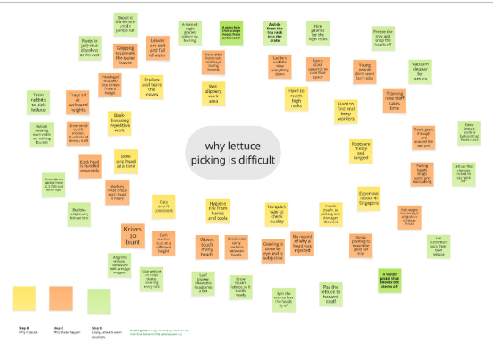
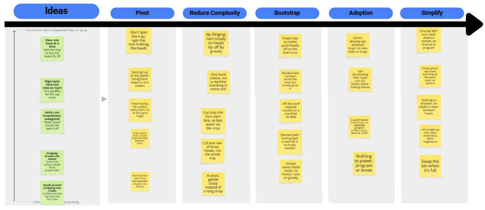
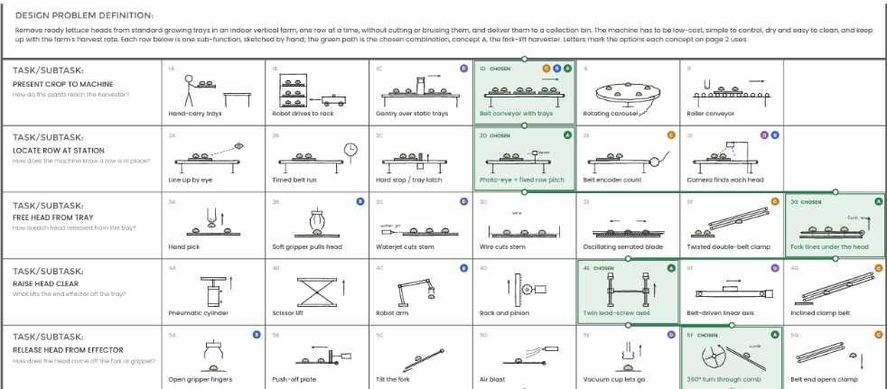
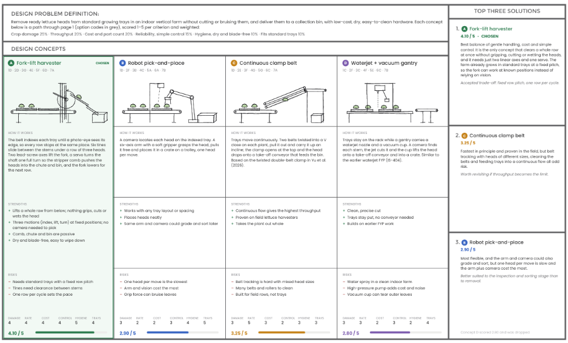

# 2. Concept Development and Selection

## 2.1 Systematic Ideation

The design process began with a brainstorming exercise conducted using Miro, an online collaborative whiteboard. The team identified challenges associated with harvesting leafy green vegetables and proposed a range of unconventional solutions using virtual sticky notes. These ideas were deliberately exaggerated or impractical to encourage creative thinking without being constrained by technical feasibility during the initial ideation stage.

<figure markdown>
  { width="1100" }

  <figcaption>
    Fig. 4. Miro Board Ideation
  </figcaption>
</figure>

From the identified harvesting challenges, five promising yet unconventional ideas were shortlisted for further development. Each idea was paired with a specific harvesting problem and arranged according to its degree of unconventionality.

The shortlisted ideas underwent an iterative refinement process involving five approaches: pivoting the original concept, reducing its complexity, incorporating existing technologies, improving ease of adoption by farms, and simplifying operation. Through this process, the initial ideas were progressively transformed into more practical mechanical solutions.

For example, the proposed use of water pistols to separate lettuce stems evolved into fixed waterjet nozzles, while an oversized fork intended to scoop entire lettuce heads was refined into smaller tines capable of sliding beneath the leaves to support the crop. Similarly, the idea of using an animal to reach elevated growing racks contributed to the development of a conveyor-based approach for positioning cultivation trays.

<figure markdown>
  { width="1100" }

  <figcaption>
    Fig. 5. Iterative refinement of unconventional ideas
  </figcaption>
</figure>

These refined ideas formed the basis for subsequent concept generation, with several features incorporated into the proposed harvesting mechanisms.
## 2.2 Morphological Analysis

Following the initial ideation exercise, a morphological chart was developed to systematically explore alternative harvesting mechanisms. The overall harvesting operation was decomposed into five sub-functions:

1. Presenting the crop to the machine, 
2. Locating individual rows,
3. Separating the crop from the growing tray,
4. Lifting the harvested crop, and 
5. Releasing it from the mechanism.

For each sub-function, the team brainstormed and sketched multiple potential solutions. These included mechanisms adapted from existing technologies as well as original concepts developed during the ideation process.

<figure markdown>
  { width="1000" }

  <figcaption>
    Fig. 6. Morphological Chart
  </figcaption>
</figure>

By combining different solutions across the sub-functions, four distinct harvesting concepts were developed:

1. **Concept A** — Fork-Lift Harvester: Uses mechanical tines to support and lift lettuce heads along a cultivation row.

2. **Concept B** — Robotic Pick-and-Place: Employs a robotic manipulator and end-effector to handle individual crops.

3. **Concept C** — Continuous Clamp Belt: Uses opposing moving belts to grip and transport harvested crops.

4. **Concept D** — Waterjet and Vacuum Entry: Combines waterjet cutting with vacuum-assisted crop handling.

<figure markdown>
  { width="1000" }

  <figcaption>
    Fig. 6. Four harvesting concepts generated from the morphological chart
  </figcaption>
</figure>

These concepts were subsequently evaluated to identify the most suitable approach for further development.

## 2.3 Review of Existing Harvesting Technologies

## 2.4 Concept Evaluation and Selection

## 2.5 Final Concept Selection

## 2.6 Summary of Selected Concept