# 3. Design Development

## 3.1 Ideation

Using a Miro board, we brainstormed ideas and solutions on virtual sticky notes. From the "difficult" board, we picked our five most useful "lousy" ideas. Each one pairs a silly solution with a problem, and we sorted them by how unusual they are (Figure 2). We then pushed each idea through an iteration process: pivot it, reduce its ambition, build it from things that already exist, make it easier for a farm to adopt, and make it easier to use (Figure 3). The two best ideas were then chosen and pitched (Figure 4).

<figure markdown>
  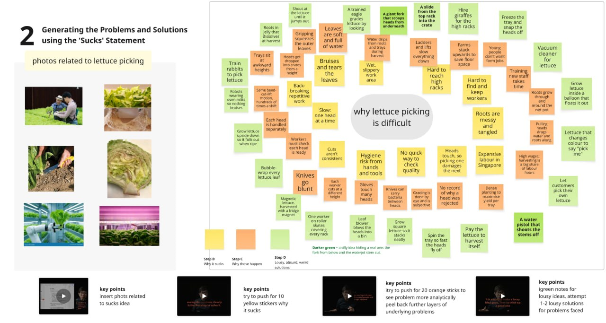{ width="1000" }

  <figcaption>
    Figure 2: Miro board: why lettuce picking is difficult (yellow) and deliberately "lousy" solutions (green).
  </figcaption>
</figure>

<figure markdown>
  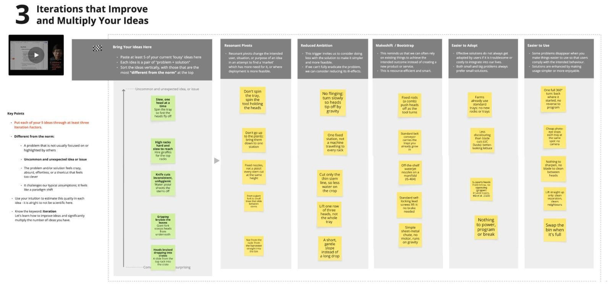{ width="1000" }

  <figcaption>
    Figure 3: Iterating the lousy ideas: pivot, reduce the ambition, build from what exists, ease adoption and use.
  </figcaption>
</figure>

<figure markdown>
  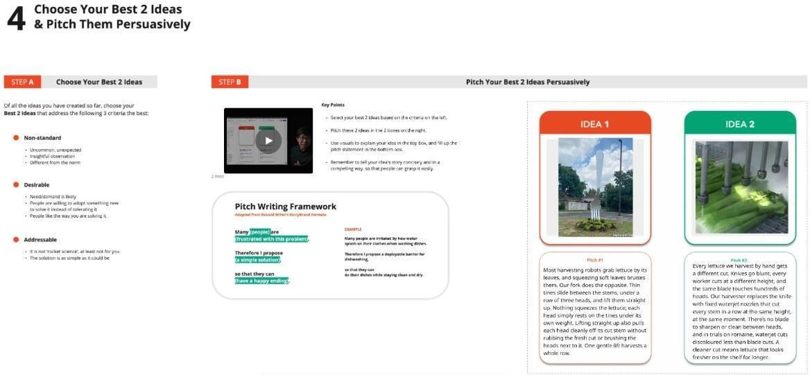{ width="1000" }

  <figcaption>
    Figure 4: Choosing the two best ideas and pitching them.
  </figcaption>
</figure>

Every main part of our CAD and designs can be traced back to an idea on this board (Figure 5):

- The conveyor belt indexes a tray forward until a photo eye detects the edge of the tray.
- The water pistols became off-the-shelf water nozzles that cut the stem cleanly.
- The giant forks became small tines that slide in between the stems and underneath the lettuce heads.

<figure markdown>
  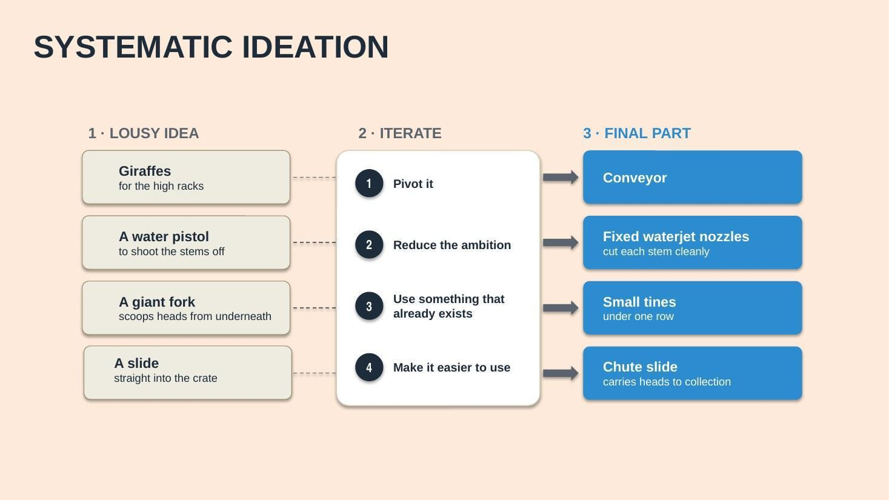{ width="1000" }

  <figcaption>
    Figure 5: From lousy idea to final part: each main component traces back to the ideation board.
  </figcaption>
</figure>

## 3.2 Functional Decomposition and Concept Selection

We then moved on to the morphological chart, where the team broke the harvesting task down into sub-functions: presenting the crop to the machine, locating each row, freeing the head from the tray, raising it clear, releasing it from the end effector, moving it to collection, and storing it (Figure 6). For each sub-function, we brainstormed and sketched as many ways of doing it as we could. Some came from existing solutions and others were our own ideas.

<figure markdown>
  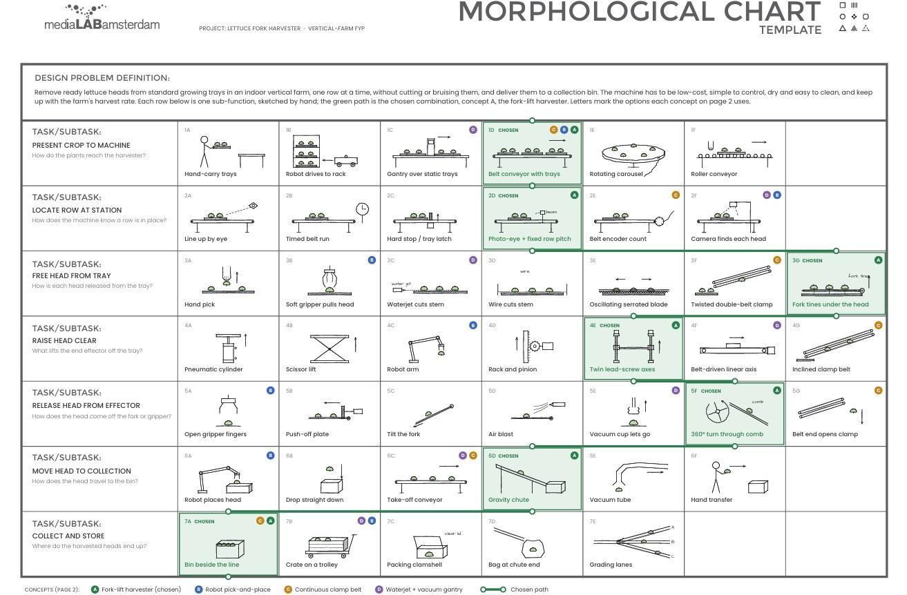{ width="1100" }

  <figcaption>
    Figure 6: Morphological chart: options for each of the seven sub-functions, with the chosen path highlighted.
  </figcaption>
</figure>

By tracing different paths through the chart, we came up with four concepts (Figure 7):

- **(A)** Fork-lift harvester
- **(B)** Robot pick and place
- **(C)** Continuous clamp belt
- **(D)** Waterjet and vacuum entry

<figure markdown>
  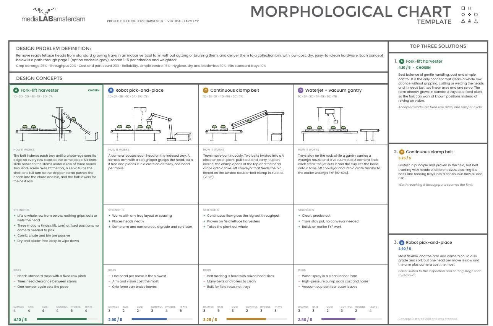{ width="1100" }

  <figcaption>
    Figure 7: Concept sheets for the leading solutions.
  </figcaption>
</figure>

We scored each concept from 1 to 5 against weighted criteria: crop damage (25%), throughput (20%), cost and part count (20%), reliability and simple control (15%), hygiene (10%) and fit with standard trays (10%). Figure 8 shows the weighted totals: the fork-lift harvester scored 4.10, ahead of the clamp belt (3.25), the robot arm (2.90) and the waterjet gantry (2.80). Crop damage carries the largest weight because a damaged head is lost revenue.

The fork-lift harvester came out best because it was the only concept that clears a whole row at once without grippers. The selected design combined concept A with the waterjet cut from concept D, but dropped D's moving gantry so that the jet stays fixed.

<figure markdown>
  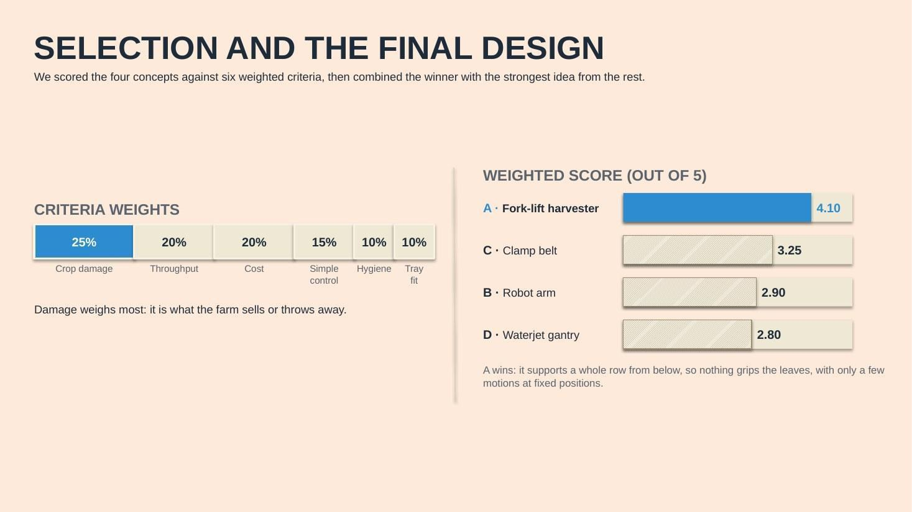{ width="1000" }

  <figcaption>
    Figure 8: Criteria weights and weighted scores out of 5 for the four concepts.
  </figcaption>
</figure>

## 3.3 Design 1: Fork-Lift Harvester

### 3.3.1 Concept

Design 1 combines the fork-lift harvester with the waterjet cut from the waterjet gantry concept. The fork lifts a row of lettuce from below, a fixed waterjet cuts the stems, and a comb strips the heads into a gravity chute. The moving gantry from the waterjet concept was dropped, so the jet stays in one place. The waterjet was kept because it cuts without touching the leaves, and in other harvesting methods gripping causes most of the damage [10].

Design 1 has six components: a conveyor that indexes the trays, the fork, the fixed waterjet, a lift, stripper comb strips, and a gravity chute into a collection bin (Figure 9). In one cycle the row slides onto the tines, the fork lifts it and turns 135°, and the comb strips the heads down the chute into the bin (Figure 10).

<figure markdown>
  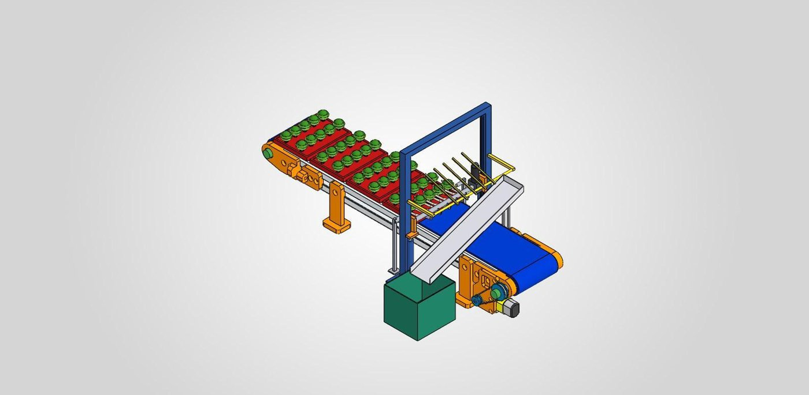{ width="900" }

  <figcaption>
    Figure 9: Design 1 in SolidWorks: conveyor, fork on the lift unit, stripper comb, discharge chute and bin.
  </figcaption>
</figure>

<figure markdown>
  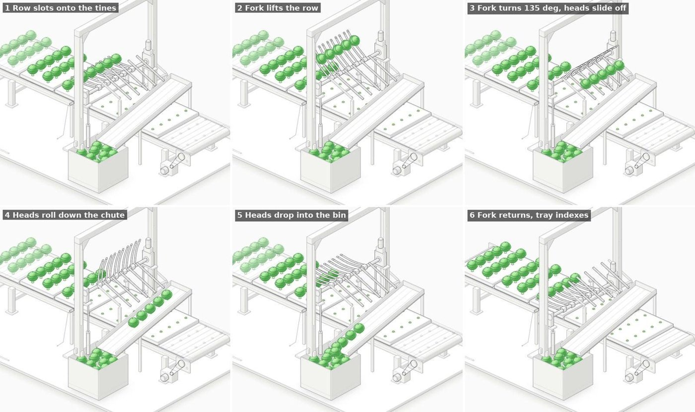{ width="1000" }

  <figcaption>
    Figure 10: One cycle of Design 1 (anatomy model, 135° turn).
  </figcaption>
</figure>

### 3.3.2 Fork Specifications

The fork has to support each lettuce without gripping it, fit between adjacent rows and carry the full mass of the plant. Its dimensions come from the lettuce measurements in [Table 1](objective.md#23-design-estimates) and from simulation (Table 3).

**Table 3:** Fork dimensions and their basis.

| Parameter | Basis | Value |
|---|---|---|
| Tine gap (T) | Leaf spread of about 330 mm divided by 4 | ≈ 76 mm |
| Maximum tine gap | The fork must not hit lettuce in adjacent rows | T < 280 mm |
| Tine width | 14.45 ÷ 2π = 14.45 ÷ 6.283 | ≈ 23 mm |
| Tine length (L) | L ≥ 4D, where D = 79.5 mm from simulation | ≥ 318 mm (4 × 79.5 mm) |

The final design rounds the calculated values and keeps the tine length, width and gap in a ratio of 320 : 23 : 75 (Table 4).

**Table 4:** Final fork dimensions.

| Dimension | Value |
|---|---|
| Tine length | 320 mm |
| Tine width | 23 mm |
| Tine gap | 75 mm |

### 3.3.3 CAD and Assembly

The fork has a steerer tube, headset cups, a crown, tines, and holes for the waterjet stream (Figure 11). The parts were modelled in SolidWorks from sketches with extrude, revolve and reference-geometry features.

<figure markdown>
  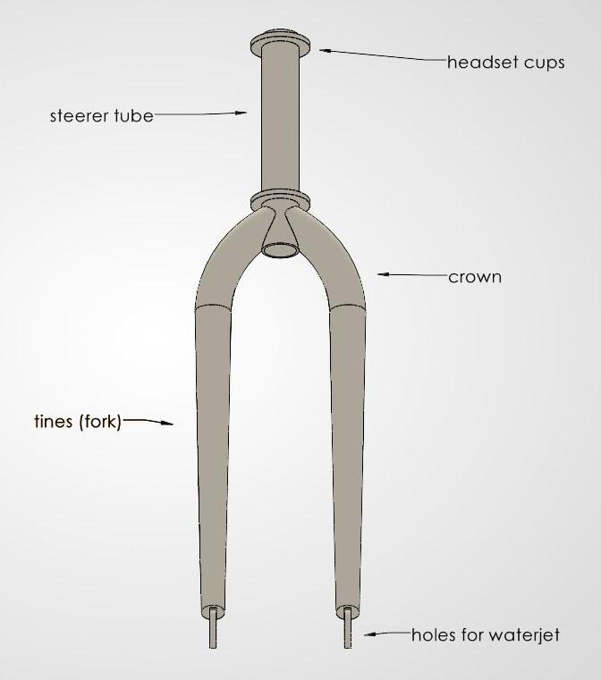{ width="240" style="display: inline-block;" }
  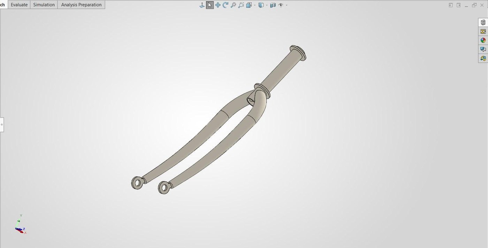{ width="440" style="display: inline-block;" }

  <figcaption>
    Figure 11: Fork parts (left) and fork CAD (right).
  </figcaption>
</figure>

The assembly was built from the bottom up, with mates only where parts move. Parts that never move, such as the rotor shaft, head tubes and forks, were placed at exact coordinates and fixed.

**Lift unit.** The rotor axis and the bearing axis are coincident, so the shaft is centred in its bearings and can only spin or slide along its length. The rotor's front plane is coincident with the lift unit's front plane, which stops the sliding (Figure 12). The lift unit has two positions in the simulation (Figure 13, Table 5).

<figure markdown>
  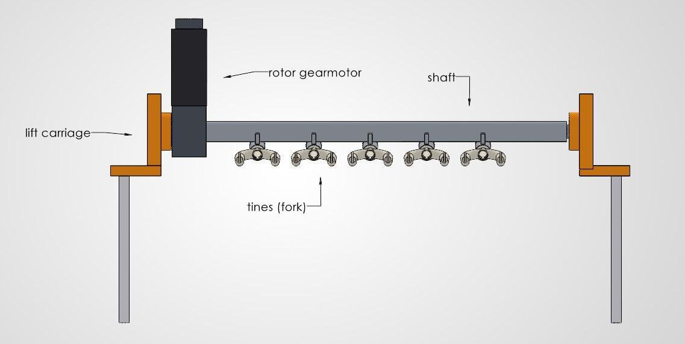{ width="800" }

  <figcaption>
    Figure 12: Lift unit: rotor gearmotor, shaft, lift carriage and tines.
  </figcaption>
</figure>

<figure markdown>
  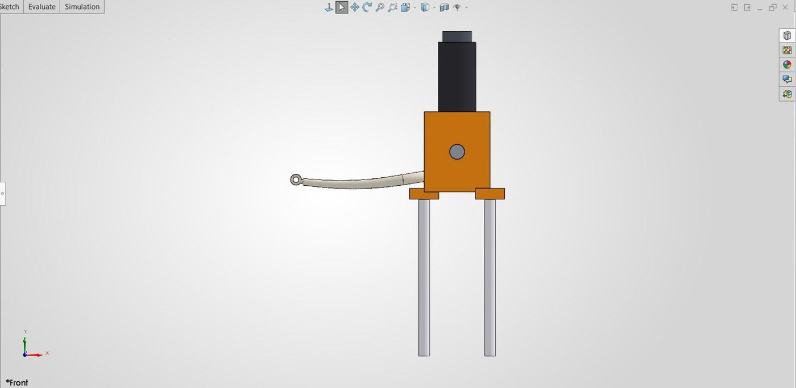{ width="340" style="display: inline-block;" }
  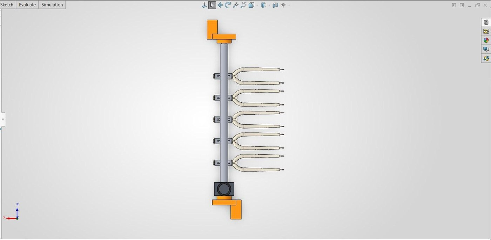{ width="340" style="display: inline-block;" }

  <figcaption>
    Figure 13: Lift unit at the harvest position (left) and the strip position (right).
  </figcaption>
</figure>

**Table 5:** Lift-unit positions in the simulation.

| | 1: Harvest | 2: Strip |
|---|---|---|
| Rotor height | 526 mm | 885 mm |
| Fork angle | Level | Turned 135° |
| During simulation | Jet cuts; heads on the forks | Heads slide off the comb |

**Frame.** In the full machine the lift unit is attached to the blue frame (Figure 14). A coincident front plane stops it drifting sideways across the belt, and a coincident right plane stops it drifting along the conveyor. A distance mate sets the rotor height for each position, and a parallel mate between a rotor plane and a frame plane sets the fork angle.

<figure markdown>
  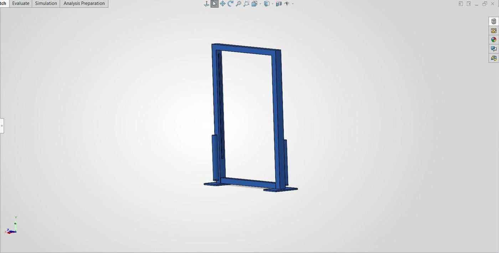{ width="700" }

  <figcaption>
    Figure 14: Blue frame carrying the lift unit.
  </figcaption>
</figure>

**Interference detection.** To find places where two parts overlap, the angle plane was turned through 360° in 15° steps, which turns the fork with it. At each step the team checked whether the fork touches the frame or the stripper combs.

### 3.3.4 Problems Found in Virtual Testing

The CAD review identified two concerns with the fork mechanism (Figure 15):

1. **Range of motor angle.** A full 360° rotation allows continuous movement in one direction, but requires enough clearance around the shaft to prevent the tines from striking the frame or comb. The interference check therefore covered the complete rotation. Limiting movement to 135° before reversing reduces the swept space, but requires controlled endpoints and repeated direction changes.
2. **Comb sticking.** The comb introduces a separate concern, as wet leaves could become trapped between its teeth and the fork during discharge.

Together, these issues prompted a closer review of how the mechanism handles each head throughout the cycle.

<figure markdown>
  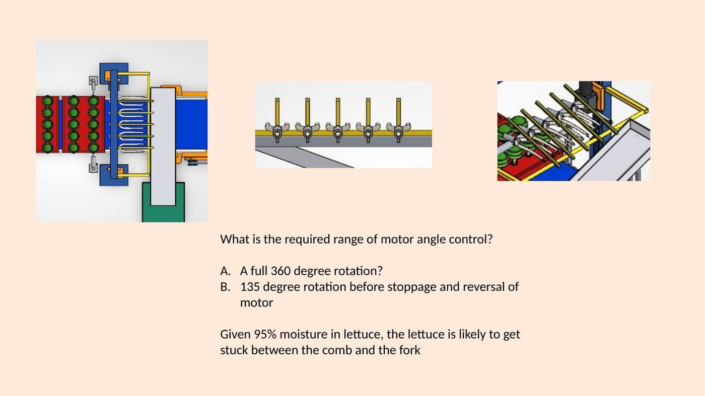{ width="900" }

  <figcaption>
    Figure 15: Questions raised by Design 1: the range of motor angle, and wet heads sticking between comb and fork.
  </figcaption>
</figure>

The anatomy model (Figure 10) revealed three further weaknesses:

- **No restraint.** The heads have no restraint as the fork lifts and rotates, leaving them vulnerable to slipping.
- **Disordered output.** The heads roll down the chute and collect in a heap, adding handling before packing. Greenphyto's continued use of manual harvesting highlights the importance of orderly, pack-ready output [14].
- **Actuator count.** Separate actuators increase coordination and maintenance demands.

Design 2 was developed to improve head retention, discharge control and mechanical simplicity.

## 3.4 Design 2: Two-Axis Gantry

Design 2 replaces the rotating fork and comb with a two-axis gantry above the conveyor's discharge end (Figure 16). The fork slides beneath the front row while a fixed waterjet cuts the stems. It then lifts the heads level and moves horizontally over the chute for release. Table 6 compares this arrangement with Design 1, building on the evaluation presented at the interim presentation.

<figure markdown>
  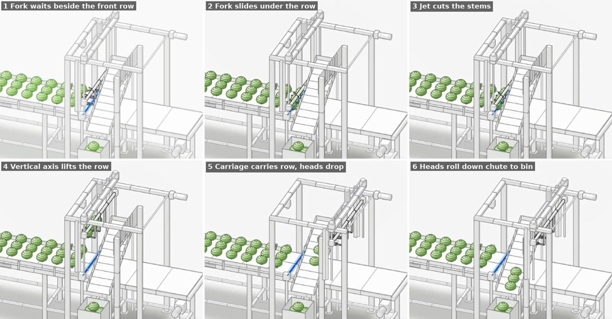{ width="1000" }

  <figcaption>
    Figure 16: One cycle of Design 2 (anatomy model, rear isometric view).
  </figcaption>
</figure>

**Table 6:** Design 1 (one gantry axis with a flip) compared with Design 2 (two-axis gantry).

| Aspect | Design 1: one axis + flip | Design 2: two-axis gantry |
|---|---|---|
| Motors | One lift axis plus a rotor for the flip | Two gantry axes, vertical and horizontal |
| Control | 360° continuous, or 135° with stop and reversal | Two axes must be coordinated; standard Cartesian motion |
| Head orientation | Tipped 135°; heads slide off under gravity | Level throughout |
| Release | Comb strips the heads; wet leaves may wedge | No comb; heads released over the chute |
| Swept space | Tines sweep an arc around the shaft | Rectangular envelope above the conveyor |
| Frame | Compact single portal | Larger portal with two rails |
| Remaining risks | Heads unrestrained during motion; drop into chute and bin | Same: heads unrestrained; drop into chute and bin |

Design 2 removes the rotational clearance and comb concerns, but adds a larger frame and a second coordinated axis. The heads remain loose on the tines and drop onto a chute during discharge. This shifted the focus towards supporting each head securely through cutting, transfer and release.

## 3.5 Design 3: Cup Holder

### 3.5.1 Single Cup

Design 3 replaces the open tines with a split, funnel-shaped cup beneath the lettuce head, flanked by two S-curved guide rails (Figure 17). As the plant advances, the rails guide the outer leaves upward and inward to ease entry into the cup (Figure 18). A rack-and-pinion mechanism closes the cup halves around the stem before the waterjet cuts below, leaving the lower stem and roots on the conveyor while supporting the head upright.

This arrangement shifts support from the leaves to the base, responding to the gripping injuries reported by Ma et al. [10]. Retaining the head after cutting also addresses the toppling problem described by a tray-harvester manufacturer [15], providing a basis for controlled transfer.

<figure markdown>
  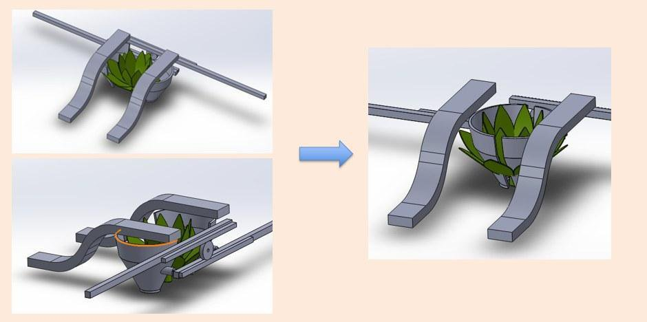{ width="800" }

  <figcaption>
    Figure 17: Design 3 CAD: early holder with S-curved arms and rail (top left), split cup on a rack and pinion (bottom left), refined holder (right).
  </figcaption>
</figure>

<figure markdown>
  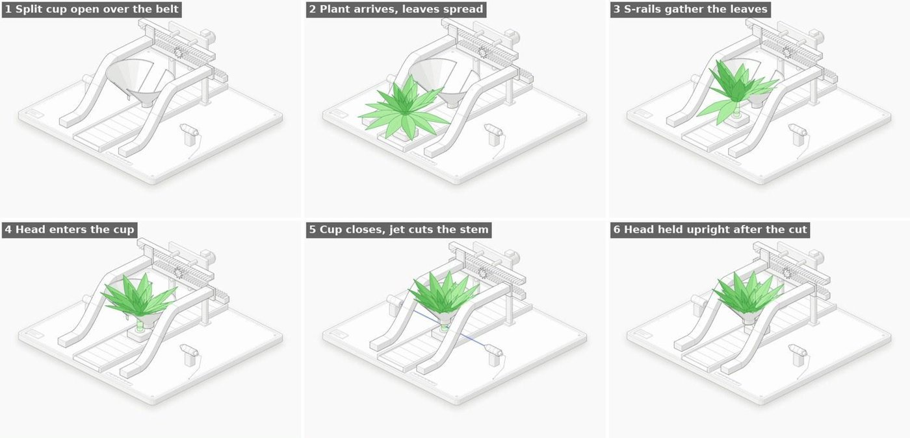{ width="1000" }

  <figcaption>
    Figure 18: One cycle of the single-cup holder (anatomy model).
  </figcaption>
</figure>

### 3.5.2 Multiple Cups

The multi-cup arrangement extends the single-head concept to four cups on a shared rack, each with its own pair of S-curved rails (Figure 19). One pinion closes the cups together, while a common waterjet line cuts beneath the stems. This restores row-by-row harvesting with one closing actuator while retaining individual support for each head during cutting.

<figure markdown>
  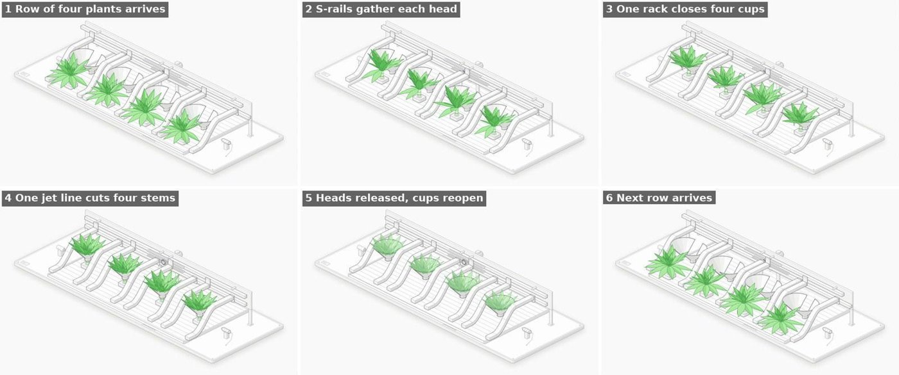{ width="1000" }

  <figcaption>
    Figure 19: One cycle of the multi-cup holder (anatomy model).
  </figcaption>
</figure>

## 3.6 Harvester_v2: Automated Lettuce Harvester without Lift

The final design builds the multi-cup holder into a station over the conveyor (Figure 20). Its key parameters are listed in Table 7, and one cycle from the SolidWorks motion study is shown in Figure 21.

<figure markdown>
  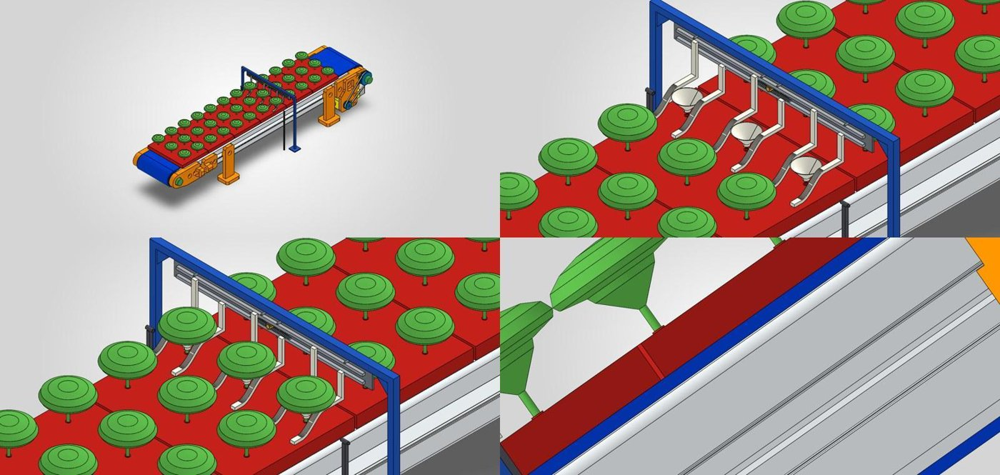{ width="1000" }

  <figcaption>
    Figure 20: Harvester in SolidWorks: station over the conveyor (top left), half-cups between S-curved tines (top right), heads in the holders (bottom left) and cut head tipped onto the tray (bottom right).
  </figcaption>
</figure>

**Table 7:** Key parameters of Harvester_v2 (from the CAD model).

| Parameter | Value |
|---|---|
| Holders per row | Three half-cup pairs at 300 mm pitch, matching the row pitch of the CAD tray model |
| Drive | One gearmotor pinion between two opposed racks, so both halves close symmetrically |
| Cup | Revolved funnel: about 21–26 mm inner diameter at the stem, 111–116 mm at the rim |
| Cup travel | Open 64 mm per side; entry 22 mm per side (44 mm gap); closed |
| Leaf guide | S-curved tine rail rising from 40 mm to 114 mm above the tray |
| Cut | One waterjet sweeping 22 mm upward through the stem zone below the cups |
| Release | Cups open; each head tips forward about 65° onto the tray beside its stub |
| Indexing | Conveyor advances 300 mm per row |
| Simulated cycle | About 8 s per row of three |

<figure markdown>
  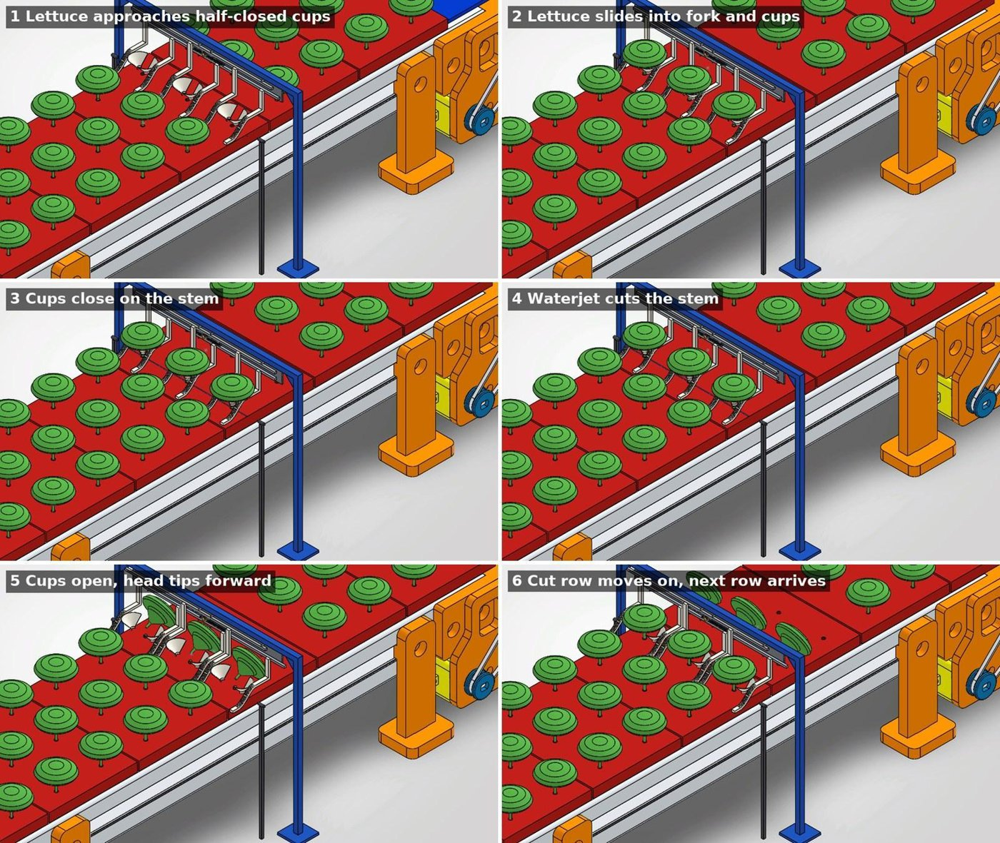{ width="900" }

  <figcaption>
    Figure 21: One cycle of Harvester_v2 from the SolidWorks motion study.
  </figcaption>
</figure>

In each cycle:

1. The tray indexes the next row in while the cups are half-closed.
2. The S-rails lift the leaves, and the stems slide into the 44 mm entry gap.
3. The racks close the cups.
4. The jet cuts the stems.
5. The cups open, and each head tips forward onto the tray with its roots exposed.
6. The row moves on.

The motion study was checked frame by frame so that no part passes through another, and the tipped head comes to rest about 0.5 mm above the tray. The head never leaves the tray's support, so there is no drop into a chute.

!!! note "Throughput"
    At about 8 s per row of three, the simulated rate is 3 × 3,600 ÷ 8 ≈ 1,350 heads per hour. That is about 13–18 times the observed manual rate of 75–100 heads per hour, within the 10–40× target set in [Section 2.3](objective.md#23-design-estimates). The cycle time is a motion-study assumption that must be confirmed on hardware.

!!! note "Closing force"
    Because one pinion drives both racks, the closing force is set by motor torque: F = T / r. With a pitch radius of 10 mm and three cups per rack, limiting each cup to a force Fc requires T = 3 Fc r. For an illustrative Fc of 2 N this is only 0.06 N·m. Crop safety therefore depends on limiting motor current, not on motor size. The safe value of Fc is unknown and is the target of test T2 ([Section 5](future-work.md)).

**Table 8:** How each design answered the weakness of the one before.

| Design | What it fixed | What it left open |
|---|---|---|
| 1: Fork lift + flip | Clears a whole row at once without grippers | Lift actuator; loose heads; comb sticking; drop into chute and bin |
| 2: Two-axis gantry | No flip, no comb; heads stay level | Two coordinated motors; heads still loose; still a drop |
| 3: Single cup | Head gathered and held gently through the cut | One head per cycle |
| 3: Multi-cup | A row per cycle with one drive and one jet | Release path; even closing; jet sizing |
| Final: Harvester_v2 | Opposed racks on one pinion; heads stay on the tray, no drop | Jet pressure, cup force and release still to be tested |

## 3.7 Waterjet Stem Cutting

### 3.7.1 Pressure Washer Comparison

Four off-the-shelf pressure washers were compared as the water supply for the jet (Table 9). Prices are as listed on the design slide; the Sun Joe price is in US dollars.

**Table 9:** Pressure washer comparison. Specifications from manufacturer or retailer pages [16]–[19].

| Specification | Makita HW102 | Makita HW1300 | Kärcher K5 | Sun Joe SPX3000 |
|---|---|---|---|---|
| Price (team survey) | $200 | $600 | $880 | US$200 |
| Max pressure | 100 bar (1,450 psi) | 130 bar (1,885 psi) | 145 bar (2,103 psi) | 140 bar (2,030 psi) |
| Flow | 6 L/min | 7.5 L/min | 8.3 L/min | 6.7 L/min |
| Motor | 1,300 W universal | 1,800 W universal | 2,100 W, water-cooled | 1,800 W universal |
| Self-priming (draws water from a tank) | Not stated | Yes | Yes | Not stated |
| Adjustable pressure | No | Yes | Yes | No |

### 3.7.2 Jet Calculations

In 2013, UC Davis and Fresh Express ran two trials comparing knife cutting with waterjet cutting of salad-cut romaine [20]. Lettuce was cut into 2-inch pieces, bagged in air and stored at 2.5 °C for up to 20 days, then scored for visual quality, discoloration and whitening of the cut edges. Waterjet-cut romaine kept better cut-surface quality than blade-cut romaine (Figure 22) [21]. The trials used an industrial waterjet pump at 35,000–55,000 psi (about 2,400–3,800 bar), far above the 100–145 bar of the washers in Table 9, so the jet for this design has to be sized separately.

<figure markdown>
  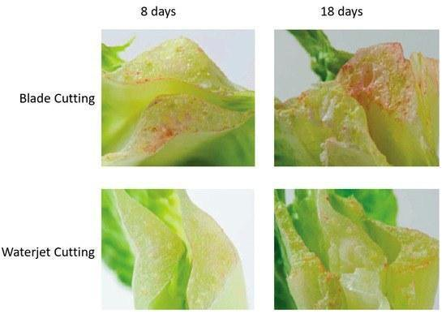{ width="550" }

  <figcaption>
    Figure 22: Blade-cut and waterjet-cut romaine after 8 and 18 days of storage (UC Davis and Fresh Express trials; KMT Waterjet, 2013 [20]).
  </figcaption>
</figure>

These figures assume each washer runs at its maximum pressure and maximum flow at the same time, with no losses in the hose or nozzle and one nozzle taking the whole flow. Pressure P is in pascals (1 bar = 100,000 Pa), flow Q is in m³/s (1 L/min = 1/60,000 m³/s) and water density ρ is 1000 kg/m³.

- **Jet velocity:** v = √(2P / ρ)
- **Hydraulic power:** P × Q
- **Equivalent nozzle diameter:** d = √(4Q / (π × v))
- **Jet force on the target:** F = ρ × Q × v

**Worked example**, Makita HW102 (100 bar, 6 L/min):

- v = √(2 × 10,000,000 ÷ 1000) ≈ 141 m/s
- Hydraulic power = 10,000,000 Pa × 0.0001 m³/s = 1,000 W
- Nozzle diameter = √(4 × 0.0001 ÷ (π × 141)) ≈ 0.95 mm
- Jet force = 1000 × 0.0001 × 141 ≈ 14 N

Applying the same relations to all four washers gives jet forces of 14–24 N when one nozzle takes the full flow (Table 13). The equivalent stress is the jet force spread over a 10 mm stem (78.5 mm²), the impact model used by the previous cohort [22], whose design stress is 0.30 MPa (0.20 MPa failure stress × safety factor 1.5).

**Table 13** (Appendix A)**:** Ideal jet properties for each washer (team calculation).

| Washer | Rating | Jet velocity | Hydraulic power | Nozzle diameter | Jet force | Stress on 10 mm stem |
|---|---|---|---|---|---|---|
| Makita HW102 | 100 bar, 6.0 L/min | 141 m/s | 1,000 W | 0.95 mm | 14.1 N | 0.18 MPa |
| Makita HW1300 | 130 bar, 7.5 L/min | 161 m/s | 1,625 W | 0.99 mm | 20.2 N | 0.26 MPa |
| Kärcher K5 | 145 bar, 8.3 L/min | 170 m/s | 2,014 W | 1.02 mm | 23.7 N | 0.30 MPa |
| Sun Joe SPX3000 | 140 bar, 6.7 L/min | 167 m/s | 1,554 W | 0.92 mm | 18.6 N | 0.24 MPa |

The previous cohort estimated, with an impact-stress model, that a 0.5 mm nozzle needs about 74 MPa to sever a 10 mm stem, assuming a tissue failure stress of 0.20 MPa and a safety factor of 1.5 [22]. That is 7.4 times the HW102's 10 MPa. On the same model, the HW102's full 14 N spread over a 10 mm stem gives 0.18 MPa, below the 0.30 MPa design stress, and sharing the flow among three stems lowers it further.

Commercial waterjet harvesters do cut whole romaine in the field [23], so the model is probably conservative: a jet cuts by eroding a narrow kerf rather than loading the whole cross-section. Pressure, nozzle size and stand-off must therefore be found by test (T1) before a pump is chosen.
