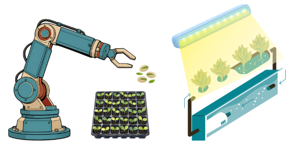

# 1. Introduction

## 1.1 Singapore's Food Security

Singapore relies heavily on imported food to
meet domestic consumption needs, with over
90% of its food supply sourced internationally [1]. This dependence exposes the country to external supply
 disruptions arising from climate change, geopolitical
  developments, and interruptions to international
   supply chains. 

To strengthen national food resilience, Singapore has adopted a multi-pronged strategy encompassing import diversification, global partnerships, stockpiling, and local food production [1].

However, expanding domestic agricultural production presents significant challenges due to Singapore's limited land availability. Historical estimates indicate that agricultural land declined from approximately 15,000 hectares in the 1960s to around 600 hectares by 2019 [2].

Consequently, space-efficient agricultural technologies, such as indoor vertical farming, offer a potential means of increasing local food production without requiring a proportional increase in land use.

## 1.2 Indoor Vertical Farming in Singapore

Vertical Farming offers an alternative to converntional land-based agriculture by cultivating crops in vertically stacked layers. In 2011, Singapore's Sky Greens developed the "A-Go-Gro" - a rotating vertical A-frame structure supporting tiers of vegetable trays. The system reported to achieve yields of up to ten times those of conventional farmland per unit area [3].

<figure markdown>
  { width="550" }

  <figcaption>
    Fig. 1. Sky Greens A-Go-Gro vertical farming system.
    Image source: [4].
  </figcaption>
</figure>

Modern Vertical Farms use controlled-environment technologies like artificial lighting, climate control and recirculating hydroponic systems to regulate growing conditions [5]. These technologies enable consistent, year-round cultivation by reducing dependence on external environmental conditions. 

Indoor vertical farming can improve water-use efficiency. Hydroponic systems reduce water losses through drip irrigation and recirculating nutrients solutions, with reported water savigns reaching up to 95% compared with traditional cultivation under controlled conditions [6].

<figure markdown>
  { width="550" }

  <figcaption>
    Fig. 2. Recirculating Hydroponics System.
    Image source: [7].
  </figcaption>
</figure>

Leafy green vegetables, such as lettuce and bok choy, are particularly relevant to indoor vertical farming due to their relatively short cultivation cycles and suitablilty for hydroponic growing systems [8]

## 1.3 Automation in Indoor Farming

Automation can improve operational efficiency of indoor vertical farms by reducing manual intervention in repetitive processes. 

ArianeTech, our industry partner for this project, is a Singapore-based agricultural technology solutions provider specialising in indoor vertical farming systems. The company offers integrates solutions incorporating automted cultivation systems and equipment like smart environmental control systems [9].

For the cultivation of leafy green vegetables, a typical production workflow can be simplified into four main stages: seeding, transplantion, cultivation, and harvesting. ArianeTech offers solutions that automate the first four stages, while harvesting remains the focus for automation development.

<figure markdown>
  { width="550" }

  <figcaption>
    Fig. 3. Illustration of automated technologies used in seeding, transplanting and contolled-environment cultivation in indoor vertical farming.
  </figcaption>
</figure>

As the capacity for cultivation increases, the reliance on manual harvesting may constrain production throughput and increase labour requirements. Developing an automated harvesting system presents an opportunity to improve the scalability and operational efficiency of indoor vertical farming.

## 1.4 Challenges of Manual Harvesting

Harvesting leafy green vegetables is not straightforward delicate physical structure and variations in plant geometry. Ma et al. investigated flexible finger gripping of hydroponic lettuce and reported injured leaf areas ranging from 120.3 mm² to 275.5 mm² across different gripping configurations [10]. This demonstrates the importance of controlling contact forces and gripping positions to minimise crop damage.

Manual harvesting also presents challenges in terms of labour productivity and scalability. Ohayama er al, evaluated an artifically illuminated lettuce production facility and reported labout productivy ranging from 1.5 to 6.0 kg per person-hour, with harvesting identified as the most time-consuming production operation [11]. Furthermore, Agrilyst's 2017 industrry survey found that labour accounted for 56% of operation expenses among surveyed indoor vertical farms [12].

As production capacity increases, dependence on manual harvesting may constrain throughput and increase labour requirements. These findings highlight the potential value of developing automated harvesting systems that minimise crop damage while enabling scalability.

## 1.5 Problem Statement

Despite advancements in the automation of indoor vertical farming, harvesting remains a labour-intensive operation within the production workflow considered in this project. As cultivation capacity increases, reliance on manual harvesting may limit production throughput, creating a bottleneck in an otherwise automated production process.

Therefore, there is a need to develop an automated harvesting system capable of handling leafy green vegetables of different geometries and qualities, efficiently and consistently, with minimal crop damage. The proposed system should also accommodate simultaneous harvesting along cultivation rows to support scalability in indoor vertical farming operations.

## 1.6 Project Objectives and Scope

### ***1.6.1 Project Objectives***

The primary objective of this project is to design and develop an automated harvesting system for leafy green vegetables cultivated in hydroponic trays within indoor vertical farms.

The specific objectives are to:

1. **Develop an automated harvesting mechanism** capable of separating and collecting mature leafy green vegetables from their growing trays.

2. **Minimise mechanical damage to crops** through suitable handling, supporting, and cutting mechanisms that accommodate variations in plant geometry.

3. **Enable simultaneous row-based harvesting** through a mechanically synchronised system to improve harvesting efficiency and scalability.

4. **Evaluate the feasibility** of the proposed design through mechanical analysis, prototyping, and functional testing.

### ***1.6.2 Project Scope***

This project focuses on the mechanical design and development of an automated harvesting system for leafy green vegetables grown in hydroponic trays. The proposed system encompasses three primary operations: supporting and handling mature crops, separating the vegetables from their stems or root systems, and transferring the harvested produce for further processing.

The design emphasises simultaneous harvesting along a cultivation row rather than individual crop harvesting. Particular consideration is given to minimising crop damage, simplifying mechanical actuation, and ensuring compatibility with the existing cultivation arrangement.

The project includes concept generation and evaluation, detailed mechanical design, prototype fabrication, and functional testing to assess the feasibility of the proposed harvesting system. The development of a fully integrated, commercial-scale harvesting system is beyond the scope of this project.