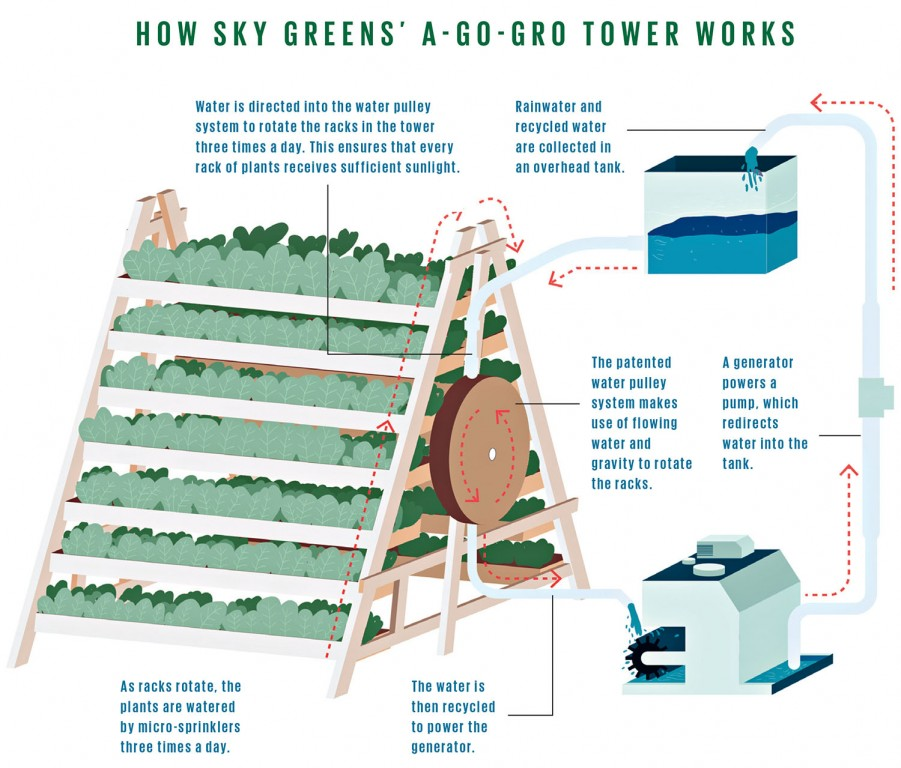
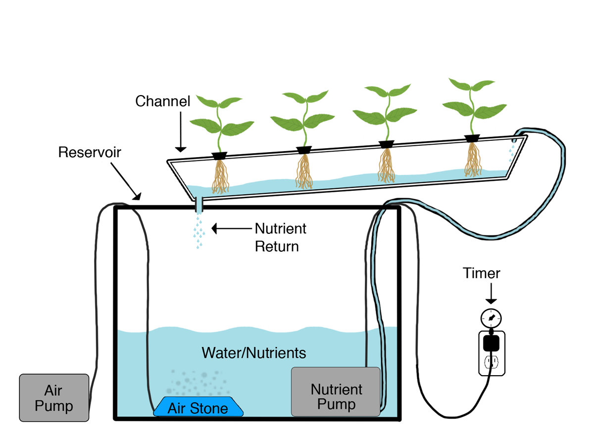

# 1. Introduction

## 1.1 Singapore's Food Security

Singapore relies heavily on imported food to
meet domestic consumption needs, with over
90% of its food supply sourced internationally [1]. This dependence exposes the country to external supply
 disruptions arising from climate change, geopolitical
  developments, and interruptions to international
   supply chains.

To strengthen national food resilience, Singapore has adopted a multi-pronged strategy encompassing import diversification, global partnerships, stockpiling, and local food production [1].

However, expanding domestic agricultural production presents significant challenges due to Singapore's limited land availability. Historical estimates indicate that agricultural land declined from approximately 15,000 hectares in the 1960s to around 600 hectares by 2019 [2].

Consequently, space-efficient agricultural technologies, such as indoor vertical farming, offer a potential means of increasing local food production without requiring a proportional increase in land use.

## 1.2 Indoor Vertical Farming in Singapore

Vertical Farming offers an alternative to converntional land-based agriculture by cultivating crops in vertically stacked layers. In 2011, Singapore's Sky Greens developed the "A-Go-Gro" - a rotating vertical A-frame structure supporting tiers of vegetable trays. The system reported to achieve yields of up to ten times those of conventional farmland per unit area [3].

<figure markdown>
  { width="550" }

  <figcaption>
    Fig. 1. Sky Greens A-Go-Gro vertical farming system.
    Image source: [4].
  </figcaption>
</figure>

Modern Vertical Farms use controlled-environment technologies like artificial lighting, climate control and recirculating hydroponic systems to regulate growing conditions [5]. These technologies enable consistent, year-round cultivation by reducing dependence on external environmental conditions. 

Indoor vertical farming can improve water-use efficiency. Hydroponic systems reduce water losses through drip irrigation and recirculating nutrients solutions, with reported water savigns reaching up to 95% compared with traditional cultivation under controlled conditions [6].

<figure markdown>
  { width="550" }

  <figcaption>
    Fig. 2. Recirculating Hydroponics System.
    Image source: [7].
  </figcaption>
</figure>

## 1.3 Automation in Indoor Farming

Content to be developed.

## 1.4 Challenges of Manual Harvesting

Content to be developed.

## 1.5 Problem Statement

Content to be developed.

## 1.6 Project Objectives and Scope

Content to be developed.
